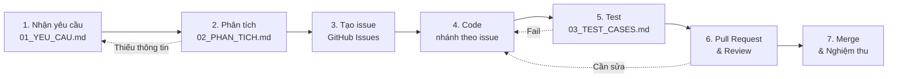

# CẨM NANG QUY TRÌNH PHÁT TRIỂN MỘT YÊU CẦU (REQUIREMENT → MERGE)
> **Phạm vi:** dùng được cho **mọi dự án** có Git + GitHub. File này không chứa thông tin riêng của dự án nào.
> **Thông tin riêng của dự án** (công nghệ, lệnh build, kiến trúc, quy ước nhánh, dữ liệu mẫu) nằm duy nhất ở [`SPECIFICATIONS.md`](SPECIFICATIONS.md).
> **Cách đọc:** Phần I xem toàn cảnh, Phần II tra bảng nhanh, Phần III làm theo từng bước, mỗi bước có **Tiêu chí nghiệm thu**.

---

## 📌 PHẦN I. SƠ ĐỒ LUỒNG THỰC HIỆN (FLOW)



* **Một yêu cầu** (requirement) có thể sinh ra **nhiều issue** (ví dụ: 1 issue logic + 1 issue giao diện).
* Mỗi yêu cầu có **một thư mục tài liệu** `docs/requirements/REQ_<số>_<TEN>/`, đi theo suốt 7 bước.
* Chưa đạt tiêu chí nghiệm thu của bước trước thì **không** sang bước sau.

---

## 📅 PHẦN II. BẢNG TÓM TẮT 7 BƯỚC & SẢN PHẨM NGHIỆM THU

| Bước | Vai trò chính | Việc chính | Sản phẩm nghiệm thu |
| :---: | :--- | :--- | :--- |
| **1. Nhận yêu cầu** | Trưởng nhóm / người phân tích | Ghi lại nguyên văn yêu cầu, nguồn, mục tiêu, tài liệu tham chiếu. | `01_YEU_CAU.md` trong thư mục `REQ_<số>_<TEN>/`. |
| **2. Phân tích** | Người phân tích + người yêu cầu | Làm rõ câu hỏi, viết quy tắc nghiệp vụ (BR-x), luồng, dữ liệu, giao diện, phạm vi; chia thành các issue. | `02_PHAN_TICH.md` được duyệt, không còn câu hỏi mở. |
| **3. Tạo issue** | Trưởng nhóm | Mỗi dòng trong bảng chia việc thành một issue trên GitHub, gắn nhãn, giao người. | Các issue trỏ về thư mục REQ, có mục Nghiệm thu đo được. |
| **4. Code** | Người nhận issue | Tạo nhánh từ nhánh chính, code theo kiến trúc và quy ước của dự án. | Code build được, commit đúng mẫu, có tham chiếu số issue. |
| **5. Test** | Người nhận issue | Viết test case từ BR-x, chạy unit test và test tay, điền kết quả. | `03_TEST_CASES.md` toàn bộ **Pass**, unit test xanh. |
| **6. Pull Request** | Người nhận issue → Reviewer | Mở PR theo mẫu, reviewer đọc phân tích trước rồi đọc code. | PR được duyệt, không conflict. |
| **7. Merge & Nghiệm thu** | Trưởng nhóm + người yêu cầu | Merge, đóng issue, demo cho người yêu cầu, cập nhật trạng thái REQ. | Issue đóng, nhánh xóa, `01_YEU_CAU.md` ghi **Đã nghiệm thu**. |

> 🤖 **Dùng AI ở bất kỳ bước nào** thì ghi vào `04_AI_LOG.md` (xem Phần V).

---

## 🚀 PHẦN III. HƯỚNG DẪN CHI TIẾT TỪNG BƯỚC (STEP-BY-STEP)

### 🟢 BƯỚC 1: NHẬN YÊU CẦU (REQUIREMENT INTAKE)
* **Đầu vào:** tin nhắn, cuộc họp, ảnh chụp trang mẫu, đề bài của giảng viên, góp ý của người dùng.
* **Mục tiêu:** ghi lại **đúng điều người yêu cầu nói**, chưa thêm ý mình, chưa nghĩ cách làm.

#### 1. Các bước thực hiện
* **1.1** Lấy số REQ tiếp theo trong bảng [`requirements/README.md`](requirements/README.md), tạo thư mục từ mẫu:
  ```bash
  cp -R docs/requirements/_TEMPLATE docs/requirements/REQ_<số 3 chữ số>_<TEN_KHONG_DAU>
  ```
  Ví dụ: `docs/requirements/REQ_001_DANG_NHAP_BANG_MA/`.
* **1.2** Điền `01_YEU_CAU.md`:
  * **Nguyên văn yêu cầu:** chép đúng lời người yêu cầu (tin nhắn, đề bài). Ảnh tham chiếu lưu cùng thư mục.
  * **Người yêu cầu, ngày nhận, mức ưu tiên, hạn mong muốn.**
  * **Mục tiêu:** người dùng nào, làm được gì, để làm gì (dạng *User Story*: "Là ..., tôi muốn ..., để ...").
  * **Tiêu chí chấp nhận của người yêu cầu:** họ sẽ kiểm tra gì để nói "xong".
* **1.3** Thêm một dòng vào bảng trong `requirements/README.md` với trạng thái **Mới**.

#### 2. Tiêu chí nghiệm thu Bước 1
- [ ] Có thư mục `REQ_<số>_<TEN>/` với `01_YEU_CAU.md` đã điền.
- [ ] Có nguyên văn yêu cầu và ít nhất một tiêu chí chấp nhận.
- [ ] Yêu cầu có dòng trong bảng tổng hợp.

---

### 🟢 BƯỚC 2: PHÂN TÍCH YÊU CẦU (ANALYSIS)
* **Mục tiêu:** biến yêu cầu thành các quy tắc kiểm tra được và một bảng chia việc rõ ràng.

#### 1. Các bước thực hiện
* **2.1 Đặt câu hỏi làm rõ:** những gì yêu cầu chưa nói (giới hạn, trường hợp lỗi, quyền, dữ liệu cũ). Ghi vào mục **Câu hỏi & quyết định**, hỏi người yêu cầu, ghi câu trả lời kèm ngày.
* **2.2 Viết quy tắc nghiệp vụ** dạng `BR-1`, `BR-2`... Mỗi quy tắc **một dòng, có con số hoặc điều kiện** (ví dụ: "hết hạn sau 15 phút", "sai 5 lần thì khóa").
* **2.3 Mô tả luồng:** luồng chính, luồng lỗi. Có thể vẽ bằng mermaid.
* **2.4 Phân tích ảnh hưởng:** dữ liệu (bảng, cột, migration), endpoint/API, giao diện, cấu hình, chức năng cũ bị ảnh hưởng hoặc bị bỏ.
* **2.5 Ghi rõ Ngoài phạm vi:** những gì cố ý không làm.
* **2.6 Chia việc:** bảng các issue sẽ tạo (loại Logic / Giao diện / Dữ liệu / Tài liệu), thứ tự và phụ thuộc giữa chúng.
* **2.7 Duyệt:** người yêu cầu hoặc trưởng nhóm đọc và đồng ý. Đổi trạng thái REQ thành **Đã phân tích**.

> 💡 **Dùng AI để phân tích:** gửi `SPECIFICATIONS.md` + `01_YEU_CAU.md` cho AI với prompt:
> *"Bạn là Business Analyst. Đây là bối cảnh dự án: [SPECIFICATIONS.md]. Đây là yêu cầu mới: [01_YEU_CAU.md]. Hãy liệt kê câu hỏi cần làm rõ, đề xuất quy tắc nghiệp vụ có con số cụ thể, các thay đổi về dữ liệu/endpoint/giao diện, phần ngoài phạm vi, và chia thành các issue nhỏ có thứ tự."*
> Sau đó **tự đối chiếu với code thật**, bỏ những gì không hợp với dự án, ghi vào `04_AI_LOG.md`.

#### 2. Tiêu chí nghiệm thu Bước 2
- [ ] `02_PHAN_TICH.md` không còn câu hỏi chưa có câu trả lời.
- [ ] Mỗi quy tắc BR-x có con số hoặc điều kiện kiểm tra được.
- [ ] Có mục Ảnh hưởng, Ngoài phạm vi và bảng Chia việc.
- [ ] Người yêu cầu / trưởng nhóm đã duyệt.

---

### 🟢 BƯỚC 3: TẠO ISSUE
#### 1. Các bước thực hiện
* **3.1** Với mỗi dòng trong bảng Chia việc, tạo issue trên GitHub bằng mẫu phù hợp (**[Logic]**, **[Giao diện]**...).
* **3.2** Trong issue ghi: `Yêu cầu: docs/requirements/REQ_<số>_<TEN>/`, các BR-x issue này phụ trách, issue phụ thuộc.
* **3.3** Mục **Nghiệm thu** của issue viết thành `- [ ]` đo được (bấm gì, thấy gì), lấy từ BR-x.
* **3.4** Gắn nhãn (loại, mảng chức năng, người nhận) theo [`SPECIFICATIONS.md`](SPECIFICATIONS.md) → *Nhãn issue*, giao người, đưa vào sprint/milestone nếu dự án dùng.
* **3.5** Ghi số issue vào bảng Chia việc trong `02_PHAN_TICH.md`. Đổi trạng thái REQ thành **Đang làm**.

#### 2. Tiêu chí nghiệm thu Bước 3
- [ ] Mỗi dòng Chia việc có một issue tương ứng, số issue đã ghi ngược vào `02_PHAN_TICH.md`.
- [ ] Mỗi issue có link thư mục REQ, nhãn, người nhận và mục Nghiệm thu.

---

### 🟢 BƯỚC 4: CODE
#### 1. Các bước thực hiện
* **4.1** Tạo nhánh từ **nhánh phát triển chính** mới nhất (tên nhánh chính và mẫu tên nhánh: xem `SPECIFICATIONS.md` → *Quy ước Git*):
  ```bash
  git checkout <nhánh-chính>
  git pull origin <nhánh-chính>
  git checkout -b feature/<số-issue>-<ten-ngan>
  ```
* **4.2** Code theo **kiến trúc và quy tắc code** của dự án (`SPECIFICATIONS.md` → *Kiến trúc*). Không viết tắt qua tầng, không để dữ liệu nhạy cảm trong code.
* **4.3** Đổi cấu trúc dữ liệu thì luôn kèm **script migration** cho máy đã có dữ liệu.
* **4.4** Commit nhỏ, mỗi commit một ý, theo mẫu [Conventional Commits](https://www.conventionalcommits.org/):
  ```
  <loại>(<phạm vi>): <việc đã làm> (#<số-issue>)
  ```
  Loại: `feat`, `fix`, `refactor`, `test`, `docs`, `chore`, `content`.
* **4.5** Gặp quy tắc mơ hồ khi code: **dừng lại**, quay về Bước 2 cập nhật `02_PHAN_TICH.md`, không tự đoán.

#### 2. Tiêu chí nghiệm thu Bước 4
- [ ] Nhánh đúng mẫu tên, tách từ nhánh chính mới nhất.
- [ ] Build thành công bằng lệnh trong `SPECIFICATIONS.md`.
- [ ] Không commit file cấu hình bí mật, file build, mật khẩu, khóa API.
- [ ] Có migration nếu đổi cấu trúc dữ liệu.

---

### 🟢 BƯỚC 5: TEST
#### 1. Các bước thực hiện
* **5.1 Thiết kế test case** trong `03_TEST_CASES.md` từ các BR-x, dùng **Phân vùng tương đương** và **Phân tích giá trị biên**:
  * Mỗi BR-x có ít nhất 1 ca **Positive** và các ca **Negative**.
  * Quy tắc có con số thì có ca **biên** (đúng bằng, nhỏ hơn 1, lớn hơn 1).
  * Dữ liệu test lấy từ dữ liệu mẫu thật của dự án (`SPECIFICATIONS.md` → *Dữ liệu mẫu*).
  > 💡 Prompt AI: *"Bạn là QA Lead. Dưới đây là phân tích yêu cầu: [02_PHAN_TICH.md]. Hãy áp dụng Phân vùng tương đương và Phân tích giá trị biên để viết bảng test case theo các cột: ID, Quy tắc, Mô tả, Loại (Positive/Negative), Các bước, Dữ liệu, Kết quả mong đợi."*
* **5.2 Unit test** cho phần nghiệp vụ, ưu tiên test tham số hóa (nhiều bộ dữ liệu biên trong một hàm) và test ngoại lệ. Chạy bằng lệnh test trong `SPECIFICATIONS.md`.
* **5.3 Chạy test tay** theo bảng, điền **Pass/Fail**. Ca Fail → quay lại Bước 4 sửa, rồi chạy lại **cả bảng** (tránh sửa chỗ này hỏng chỗ khác).
* **5.4 Kiểm thử hồi quy:** chạy các luồng chính trong [`TEST_PLAN.md`](TEST_PLAN.md) để chắc chức năng cũ không hỏng.
* **5.5** Ghi lỗi tìm thấy và cách sửa vào mục **Kết quả** của `03_TEST_CASES.md`.

#### 2. Tiêu chí nghiệm thu Bước 5
- [ ] Mỗi BR-x có ít nhất một ca kiểm thử, có ca biên.
- [ ] Unit test: **100% Pass**, không có Error.
- [ ] Cột Trạng thái trong `03_TEST_CASES.md` đều **Pass**.
- [ ] Các luồng chính trong `TEST_PLAN.md` vẫn chạy được.

---

### 🟢 BƯỚC 6: PULL REQUEST & REVIEW
#### 1. Các bước thực hiện
* **6.1** Cập nhật nhánh chính vào nhánh mình, giải quyết conflict, đẩy lên:
  ```bash
  git pull origin <nhánh-chính>
  git push -u origin feature/<số-issue>-<ten-ngan>
  ```
* **6.2** Mở PR **vào nhánh phát triển chính**, điền đủ mẫu: `Closes #<số>`, link thư mục REQ, cách kiểm tra, thay đổi dữ liệu/cấu hình, ảnh chụp nếu có giao diện.
* **6.3** **Reviewer** đọc theo thứ tự: `02_PHAN_TICH.md` → code → chạy thử vài ca trong `03_TEST_CASES.md`. Góp ý bằng comment trên dòng code, phân biệt *bắt buộc sửa* và *gợi ý*.
* **6.4** Người làm sửa bằng commit mới trên cùng nhánh, trả lời từng góp ý.

#### 2. Tiêu chí nghiệm thu Bước 6
- [ ] PR đủ mục theo mẫu, checklist tích hết.
- [ ] Không conflict với nhánh chính.
- [ ] Ít nhất một reviewer đã **Approve**.

---

### 🟢 BƯỚC 7: MERGE & NGHIỆM THU
#### 1. Các bước thực hiện
* **7.1** Merge bằng **Create a merge commit**.
  > ⚠️ Không dùng *Squash and merge* khi đã có nhánh khác tách ra từ nhánh này: squash làm mất lịch sử, các PR còn lại sẽ báo conflict dù code đã có trong nhánh chính.
* **7.2** Kiểm tra issue đã tự đóng, nhánh đã xóa.
* **7.3** Khi **tất cả** issue của REQ đã merge: demo cho người yêu cầu theo *Tiêu chí chấp nhận* trong `01_YEU_CAU.md`.
* **7.4** Đạt thì ghi **Đã nghiệm thu** (ngày, người duyệt) vào `01_YEU_CAU.md` và bảng `requirements/README.md`. Chưa đạt thì ghi điểm chưa đạt và quay lại Bước 2.
* **7.5** Thông báo cho nhóm cập nhật máy (`git pull`), chạy migration nếu có.

#### 2. Tiêu chí nghiệm thu Bước 7
- [ ] Tất cả issue của REQ đã đóng, nhánh đã xóa.
- [ ] Nhánh chính build và chạy được sau khi merge.
- [ ] REQ có trạng thái **Đã nghiệm thu**.

---

## 📁 PHẦN IV. CẤU TRÚC THƯ MỤC QUY CHUẨN

```text
<du-an>/
├── .github/
│   ├── ISSUE_TEMPLATE/
│   │   ├── logic.md                    # [Bước 3] Mẫu issue logic
│   │   └── giao-dien.md                # [Bước 3] Mẫu issue giao diện
│   └── pull_request_template.md        # [Bước 6] Mẫu PR
└── docs/
    ├── HUONG_DAN_QUY_TRINH_PHAT_TRIEN.md   # Cẩm nang này (dùng chung, không sửa theo dự án)
    ├── SPECIFICATIONS.md                   # Bối cảnh RIÊNG của dự án (viết lại khi sang dự án mới)
    ├── TEST_PLAN.md                        # Kế hoạch kiểm thử RIÊNG của dự án
    └── requirements/
        ├── README.md                       # Bảng tổng hợp mọi yêu cầu
        ├── _TEMPLATE/                      # Mẫu, copy khi nhận yêu cầu mới
        │   ├── 01_YEU_CAU.md               # [Bước 1] Nhận yêu cầu
        │   ├── 02_PHAN_TICH.md             # [Bước 2, 3] Phân tích & chia issue
        │   ├── 03_TEST_CASES.md            # [Bước 5] Test case & kết quả
        │   └── 04_AI_LOG.md                # [Mọi bước] Nhật ký dùng AI
        └── REQ_001_<TEN>/                  # Mỗi yêu cầu một thư mục
```

| Loại file | File | Khi sang dự án mới |
| :--- | :--- | :--- |
| **Dùng chung** | `HUONG_DAN_QUY_TRINH_PHAT_TRIEN.md`, `requirements/_TEMPLATE/*`, `.github/ISSUE_TEMPLATE/*`, `pull_request_template.md` | Copy nguyên, chỉ sửa mục *Riêng dự án* trong mẫu PR/issue |
| **Riêng dự án** | `SPECIFICATIONS.md`, `TEST_PLAN.md`, `requirements/README.md`, các thư mục `REQ_*` | Viết mới |

---

## 🧰 PHẦN V. NHẬT KÝ DÙNG AI (`04_AI_LOG.md`)

Mỗi lần dùng AI là một mục, gồm 4 phần (theo chuẩn môn SOF309):

1. **Ngữ cảnh & mục tiêu:** bước nào, cần AI làm gì.
2. **Prompt đã gửi:** chép nguyên văn.
3. **Kết quả AI trả về:** tóm tắt hoặc dán phần chính.
4. **Chỉnh sửa của người làm & lý do:** AI sai/thiếu chỗ nào, đã sửa thế nào, vì sao.

Mục 4 quan trọng nhất: chứng minh người làm hiểu và kiểm soát kết quả.
**Không** dán mật khẩu, khóa API, nội dung file cấu hình bí mật vào prompt hay nhật ký.

---

## 🔁 PHẦN VI. ÁP DỤNG CHO DỰ ÁN MỚI (5 BƯỚC)

1. Copy `docs/HUONG_DAN_QUY_TRINH_PHAT_TRIEN.md`, `docs/requirements/_TEMPLATE/`, `.github/ISSUE_TEMPLATE/`, `.github/pull_request_template.md` sang repo mới.
2. Viết `docs/SPECIFICATIONS.md` theo khung của file mẫu (thông tin dự án, công nghệ, lệnh chạy, kiến trúc, quy ước Git, nhãn, dữ liệu mẫu, checklist riêng).
3. Viết `docs/TEST_PLAN.md` (mục tiêu, phạm vi, cấp độ test, luồng chính).
4. Tạo `docs/requirements/README.md` với bảng trống, sửa mục *Riêng dự án* trong mẫu PR/issue.
5. Trên GitHub: tạo nhãn theo `SPECIFICATIONS.md`, bật *Automatically delete head branches*, đặt nhánh mặc định là nhánh phát triển chính.

---

## 🎯 PHẦN VII. MỨC HOÀN THÀNH MỘT YÊU CẦU (DEFINITION OF DONE)

| Mức | Yêu cầu | Chi tiết nghiệm thu |
| :---: | :--- | :--- |
| **A (Hoàn chỉnh)** | **Bước 1 đến 7** | Đủ 4 file REQ, test case toàn bộ Pass, có unit test cho nghiệp vụ, PR đủ mục, đã merge và **người yêu cầu đã nghiệm thu**. |
| **B (Đạt)** | **Bước 1 đến 6** + merge | Có phân tích, code và test chạy đúng, nhưng thiếu unit test, thiếu nhật ký AI hoặc chưa demo nghiệm thu. |
| **C (Tạm)** | **Bước 3, 4, 6** | Có issue và PR, code chạy, nhưng không có tài liệu yêu cầu. Chỉ chấp nhận cho việc rất nhỏ (sửa chữ, đổi màu). |
| **D (Chưa đạt)** | Thiếu issue hoặc PR | Đẩy thẳng lên nhánh chính, không có phân tích. **Không merge**, làm lại theo quy trình. |
