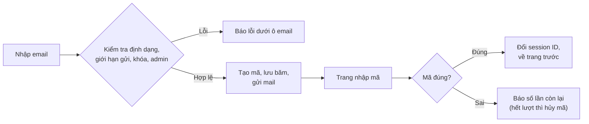

# PHÂN TÍCH YÊU CẦU REQ_001: Đăng nhập bằng email + mã 6 số, khung tài khoản dạng popover
> *Issue và PR của yêu cầu này nằm ở repo cũ `nhan0x/saltair-fashion-web`.*
> *Ví dụ đã điền đầy đủ theo mẫu `_TEMPLATE/02_PHAN_TICH.md`.*

---

## 1. CÂU HỎI & QUYẾT ĐỊNH ĐÃ CHỐT
| # | Câu hỏi | Quyết định | Người chốt | Ngày |
| :---: | :--- | :--- | :--- | :--- |
| 1 | Giữ đăng nhập bằng mật khẩu song song không? | Bỏ hẳn mật khẩu (xóa đăng ký, quên/đổi mật khẩu) | Trưởng nhóm | 10/11 |
| 2 | Admin đăng nhập thế nào? | Phương án 1: trang riêng `/admin/login`, mã ngắn hạn hơn khách | Trưởng nhóm | 10/11 |
| 3 | Thêm ô "Nhận ưu đãi qua email" (cột `marketing_opt_in`)? | Không, chỉ giữ cột thật sự dùng | Trưởng nhóm | 10/11 |
| 4 | Tài khoản mẫu là email giả, demo thế nào? | Thêm cấu hình `auth.devCode` hiện mã trên trang | Trưởng nhóm | 10/11 |
| 5 | Popover có làm mờ nền như khung tìm kiếm không? | Không làm mờ nền | Trưởng nhóm | 10/11 |

## 2. QUY TẮC NGHIỆP VỤ (BUSINESS RULES)

**Mã đăng nhập**
* **BR-1:** Mã gồm 6 chữ số, tạo bằng `SecureRandom`, cho phép số 0 đứng đầu.
* **BR-2:** DB chỉ lưu `SHA-256(email + ":" + mã)` dạng hex, không lưu mã gốc.
* **BR-3:** Xin mã mới thì mọi mã cũ chưa dùng của email đó hết hiệu lực.
* **BR-4:** Mỗi mã chỉ dùng được một lần (kiểm tra trong transaction có `SELECT ... FOR UPDATE`).
* **BR-5:** Hạn dùng tính bằng `NOW()` của MySQL.

**Luồng khách**
* **BR-6:** Mã hết hạn sau **15 phút**. Nhập sai **5 lần** thì mã bị hủy.
* **BR-7:** Xin lại mã sau ít nhất **60 giây**, tối đa **5 mã mỗi giờ** cho một email. Vượt thì báo "Bạn thử lại sau ít phút."
* **BR-8:** Email chưa có tài khoản: nhập đúng mã thì tạo tài khoản `CUSTOMER`, `full_name` là phần trước `@`.
* **BR-9:** Tài khoản bị khóa không xin được mã: báo "Tài khoản đã bị khóa...".
* **BR-10:** Email của admin nhập ở luồng khách: báo câu chuyển sang trang quản trị, kèm link `/admin/login`.

**Luồng admin**
* **BR-11:** Mã hết hạn sau **5 phút**, sai **3 lần** thì hủy, tối đa **3 mã mỗi giờ**.
* **BR-12:** Luôn báo cùng một câu dù email có phải admin hay không; email không phải admin thì không gửi mã. Không tự tạo tài khoản admin.
* **BR-13:** Phiên admin hết hạn sau **30 phút** không thao tác. Mỗi lần đăng nhập gửi mail báo (thời gian, IP, trình duyệt).

**Chung**
* **BR-14:** Email đang chờ nhập mã lưu trong session, không đặt lên URL. Đăng nhập xong thì đổi session ID.
* **BR-15:** Khách quay về trang đang xem (đường dẫn nội bộ an toàn) hoặc `/home`; admin về `/admin`.
* **BR-16:** `auth.devCode=true`: không gửi mail, mã hiện trên trang và trong log. Mặc định `false`, khi đó mã không bao giờ lộ ra log hay giao diện.

**Giao diện**
* **BR-17:** Bấm icon người mở popover cách mép trên và phải 20px, rộng 360px, trồi lên 20px trong 240ms, không làm mờ nền; đóng bằng X, bấm ra ngoài, `Esc`.
* **BR-18:** Trang nhập mã có 6 ô số: tự nhảy ô, dán cả mã, đủ 6 số tự gửi; mã sai thì rung và báo số lần còn lại; nút gửi lại đếm ngược 60 giây.

## 3. LUỒNG XỬ LÝ

## 4. PHÂN TÍCH ẢNH HƯỞNG
| Phần | Thay đổi | Ghi chú |
| :--- | :--- | :--- |
| **Dữ liệu** | Thêm bảng `login_codes` (7 cột, index `(email, created_at)`); xóa `users.password_hash` và bảng `password_resets` | Migration: `database/migration_02_bo_mat_khau.sql` |
| **Endpoint** | Thêm `POST /login/email`, `GET/POST /login/code`, `POST /login/code/resend`, `GET/POST /admin/login`, `GET/POST /admin/login/code`. `/register`, `/forgot-password`, `/reset-password` chuyển về `/login` | Trả JSON khi gọi bằng `fetch` (popover) |
| **Giao diện** | Popover tài khoản trong `layout.tag`; trang nhập mã riêng không header/footer | |
| **Cấu hình** | `auth.devCode` trong `mail.properties` (mặc định `false`) | |
| **Chức năng cũ** | Bỏ đăng ký, quên/đặt lại/đổi mật khẩu, thư viện `jbcrypt`; `AdminFilter` chuyển về `/admin/login` | Cập nhật bộ kiểm thử toàn luồng |

## 5. NGOÀI PHẠM VI
* Ô "Nhận ưu đãi qua email" và cột `marketing_opt_in`.
* Đăng nhập bằng Google/Facebook.
* Gửi mã qua SMS.

## 6. CHIA VIỆC THÀNH ISSUE
| Thứ tự | Loại | Tên issue | Quy tắc phụ trách | Phụ thuộc | Issue |
| :---: | :--- | :--- | :--- | :--- | :---: |
| 1 | Logic | [Logic] Đăng nhập bằng email + mã 6 số, bỏ hẳn mật khẩu | BR-1 → BR-16 | | #74 |
| 2 | Giao diện | [Giao diện] Khung tài khoản dạng popover + trang nhập mã 6 ô | BR-17, BR-18 | Thứ tự 1 | #75 |

## 7. DUYỆT PHÂN TÍCH
* **Người duyệt:** Trưởng nhóm · **Ngày:** 10/11/2026
