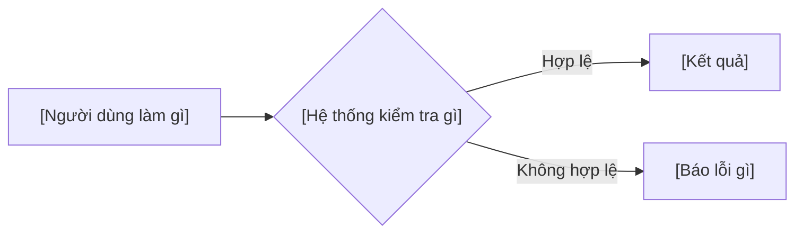

# PHÂN TÍCH YÊU CẦU REQ_[số]: [Tên ngắn]
> Bước 2 và 3 trong [HUONG_DAN_QUY_TRINH_PHAT_TRIEN.md](../../HUONG_DAN_QUY_TRINH_PHAT_TRIEN.md). Bối cảnh dự án: [SPECIFICATIONS.md](../../SPECIFICATIONS.md).

---

## 1. CÂU HỎI & QUYẾT ĐỊNH ĐÃ CHỐT
| # | Câu hỏi | Quyết định | Người chốt | Ngày |
| :---: | :--- | :--- | :--- | :--- |
| 1 | [Điều yêu cầu chưa nói rõ] | [Câu trả lời] | [Tên] | [dd/mm] |

## 2. QUY TẮC NGHIỆP VỤ (BUSINESS RULES)
> Mỗi quy tắc một dòng, có con số hoặc điều kiện kiểm tra được. Test case trỏ về các mã BR-x này.

* **BR-1:** [...]
* **BR-2:** [...]

## 3. LUỒNG XỬ LÝ

1. **Luồng chính:** [...]
2. **Luồng lỗi:** [...]

## 4. PHÂN TÍCH ẢNH HƯỞNG
| Phần | Thay đổi | Ghi chú |
| :--- | :--- | :--- |
| **Dữ liệu** | [Bảng/cột thêm, sửa, xóa. Không đổi ghi "Không"] | Migration: `[tên file]` |
| **Endpoint / API** | [Phương thức, đường dẫn, tham số, kết quả] | |
| **Giao diện** | [Trang, trạng thái trống / đang xử lý / lỗi / thành công] | |
| **Cấu hình** | [Khóa cấu hình mới, giá trị mặc định] | |
| **Chức năng cũ** | [Chức năng bị sửa hoặc bỏ] | |

## 5. NGOÀI PHẠM VI
* [Những gì cố ý không làm trong yêu cầu này.]

## 6. CHIA VIỆC THÀNH ISSUE
| Thứ tự | Loại | Tên issue | Quy tắc phụ trách | Phụ thuộc | Issue |
| :---: | :--- | :--- | :--- | :--- | :---: |
| 1 | Logic | [Logic] [...] | BR-1, BR-2 | | #[số] |
| 2 | Giao diện | [Giao diện] [...] | BR-3 | Thứ tự 1 | #[số] |

## 7. DUYỆT PHÂN TÍCH
* **Người duyệt:** [Tên] · **Ngày:** [dd/mm/yyyy]
